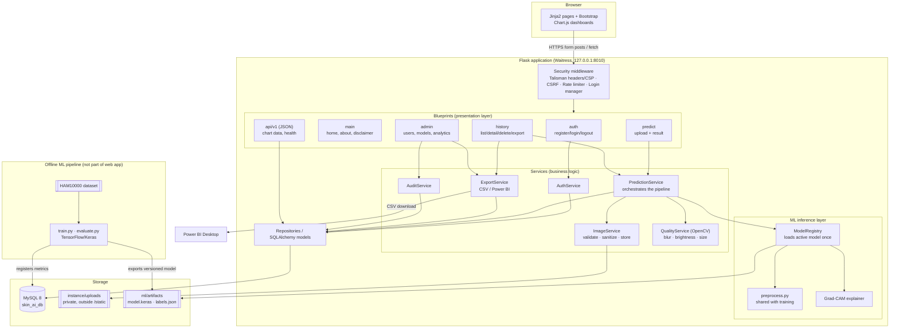
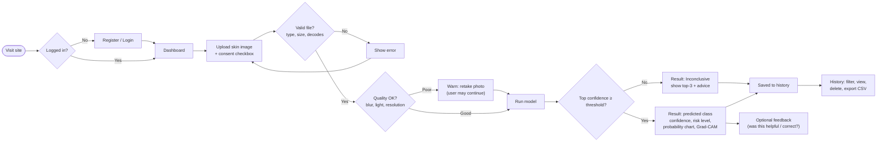
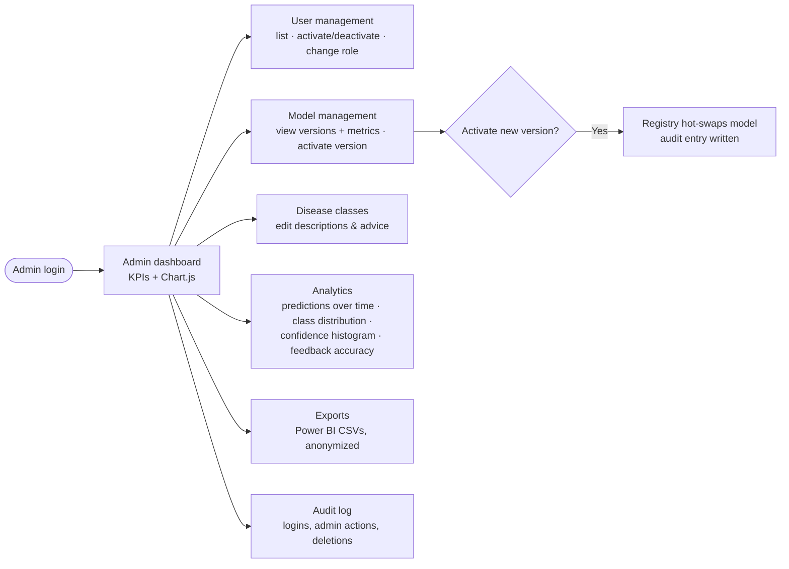
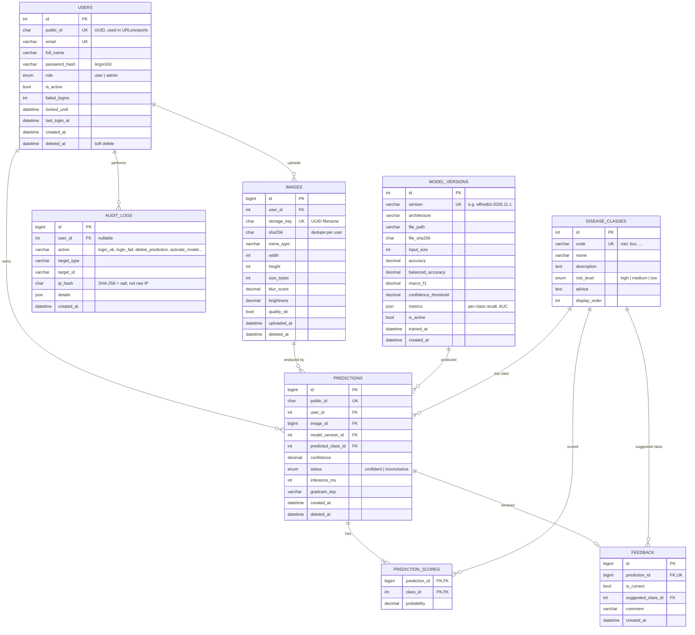
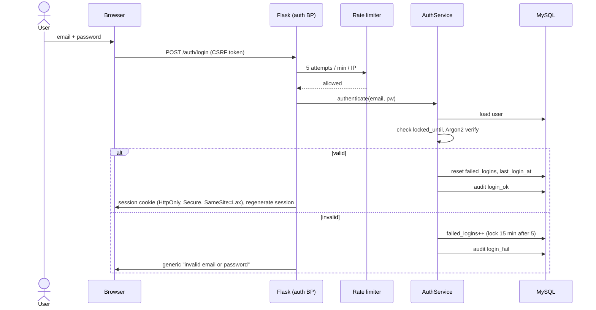
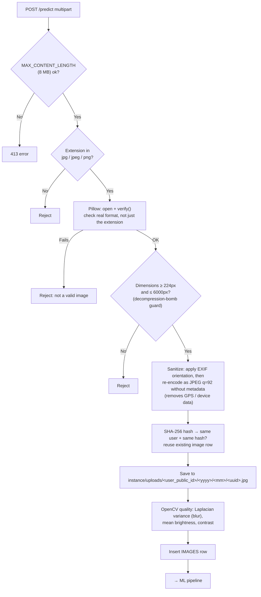
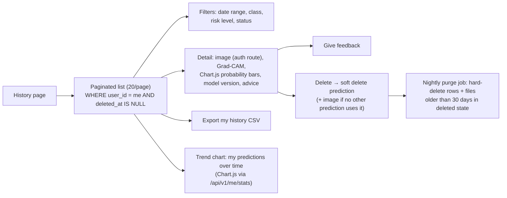

# Software Architecture: AI-Based Skin Disease Detection and Classification System

**Status:** Draft for review · **Version:** 0.1 · **Date:** 2026-11-10

> Scope: classification of **skin-lesion images only**. The system supports screening and
> education. It is **not** a diagnostic device. Every result carries a medical disclaimer.

---

## 0. Technology stack

| Layer | Technology | Why |
|---|---|---|
| UI | Jinja2 templates, Bootstrap 5, vanilla JS, Chart.js | Server-rendered pages are simple and secure (CSRF and sessions work out of the box) and need no separate build step |
| Web framework | Flask 3 (app factory + Blueprints) | Lightweight; Blueprints keep features in separate modules |
| Extensions | Flask-Login, Flask-WTF (CSRF), Flask-SQLAlchemy, Flask-Migrate, Flask-Limiter, Flask-Talisman | Proven libraries for each concern instead of hand-written security code |
| WSGI server | Waitress | Production-grade and runs natively on Windows (Gunicorn does not) |
| Database | MySQL 8 (existing local server, dedicated DB and user) | Relational integrity for users, predictions and the model registry |
| Deep learning | TensorFlow / Keras (CPU) | Transfer learning with EfficientNetB0; saved as `.keras` |
| Image processing | Pillow (decode, validate, strip EXIF), OpenCV (quality checks, Grad-CAM overlay) | Pillow is the safe decoder; OpenCV does the computer-vision checks |
| ML support | NumPy, Pandas, scikit-learn | Data splits, metrics, class weights |
| Analytics | Chart.js dashboards + Power BI-ready CSV exports | In-app charts, plus offline BI analysis |
| Python | 3.12 in the project `.venv` | Supported by TensorFlow on Windows |

### Disease classes (HAM10000, 7 skin-lesion classes)

| Code | Condition | Risk group |
|---|---|---|
| `mel` | Melanoma | High (malignant) |
| `bcc` | Basal cell carcinoma | High (malignant) |
| `akiec` | Actinic keratosis / intraepithelial carcinoma | Medium (pre-malignant) |
| `bkl` | Benign keratosis-like lesions | Low (benign) |
| `nv` | Melanocytic nevus (mole) | Low (benign) |
| `df` | Dermatofibroma | Low (benign) |
| `vasc` | Vascular lesion | Low (benign) |

Classes live in the `disease_classes` table, not in code. A future model with more skin
classes then needs only new rows and a new `labels.json`, with no code changes.

---

## 1. Application architecture



**Layering rules (why):**
- **Blueprints** handle HTTP only: parse the form, call a service, render a template. They hold no business logic, so the logic stays testable without HTTP.
- **Services** hold the logic and are unit-testable with a fake repository and a fake model.
- **Repositories** are the only code that touches SQLAlchemy sessions, which keeps queries in one place.
- **ML layer** is isolated behind `ModelRegistry`. The web app never imports training code. Both sides import the **same** `preprocess.py`, which prevents train/serve skew.
- **Training is offline.** The web app only loads a finished, versioned artifact, so a training run can never break the running site.

---

## 2. User workflow



**Decisions:**
- **Login required** before uploading. Every image and prediction is tied to an owner, which makes privacy and deletion rights enforceable.
- **Explicit consent** at upload: the user agrees to the disclaimer and to storage of the image.
- **Quality gate warns rather than blocks.** Blurry phone photos are common, and blocking them outright frustrates users, but the warning is recorded with the prediction.
- **"Inconclusive" result** when the top probability is below a threshold (default 0.50, configurable). Showing a confident-looking wrong answer is the worst outcome for a medical-adjacent app.
- **High-risk classes** (mel, bcc, akiec) always show a "see a dermatologist promptly" banner, whatever the confidence.

---

## 3. Admin workflow



**Decisions:**
- **No default admin account.** The first admin is created with a CLI command, `flask create-admin`, run locally, which prompts for the password. This avoids shipping default credentials.
- **Admins see predictions as aggregates and pseudonymous IDs.** Viewing a specific user's image requires an explicit action that is written to the audit log (least privilege).
- **Model activation is a database flag** (`model_versions.is_active`). Rollback means re-activating the previous version, with no redeploy.
- **Every admin action is audited.**

---

## 4. Flask application structure

```
AI-Skin-Disease-Prediction/
├── run.py                          # dev entry: create_app()
├── wsgi.py                         # Waitress entry for start.ps1
├── app/
│   ├── __init__.py                 # create_app(): config, extensions, blueprints, error handlers
│   ├── config.py                   # Dev/Test/Prod config classes, read from .env
│   ├── extensions.py               # db, migrate, login_manager, csrf, limiter, talisman
│   ├── cli.py                      # flask create-admin, seed-classes, register-model
│   ├── models/                     # SQLAlchemy ORM
│   │   ├── user.py  disease_class.py  model_version.py
│   │   ├── image.py  prediction.py  feedback.py  audit_log.py
│   ├── repositories/               # query functions per aggregate
│   ├── services/
│   │   ├── auth_service.py  image_service.py  quality_service.py
│   │   ├── prediction_service.py  export_service.py  audit_service.py
│   ├── ml/                         # inference only
│   │   ├── registry.py             # thread-safe singleton; loads active .keras
│   │   ├── predictor.py            # predict(img) -> probabilities
│   │   └── gradcam.py
│   ├── blueprints/
│   │   ├── auth/      (routes.py, forms.py)
│   │   ├── main/      (routes.py)
│   │   ├── predict/   (routes.py, forms.py)
│   │   ├── history/   (routes.py)
│   │   ├── admin/     (routes.py, forms.py)
│   │   └── api/       (routes.py)      # JSON for Chart.js, /health
│   ├── security/
│   │   ├── decorators.py           # @role_required("admin")
│   │   └── passwords.py            # Argon2 hashing
│   ├── templates/                  # base.html + per-blueprint folders
│   └── static/                     # css/, js/ (charts.js), img/  (no user uploads here)
├── skinai_ml/                      # shared package imported by app AND training
│   └── preprocess.py               # resize, normalize. Single source of truth
├── ml/
│   ├── configs/train.yaml
│   ├── src/  (dataset.py, train.py, evaluate.py, export.py)
│   ├── notebooks/                  # EDA
│   ├── data/                       # git-ignored
│   └── artifacts/                  # git-ignored: <version>/model.keras, labels.json, metrics.json
├── migrations/                     # Flask-Migrate (Alembic)
├── instance/uploads/               # git-ignored, private image storage
├── tests/  (unit/, integration/, conftest.py)
├── scripts/ (setup_venv, start, stop, status, restart, db_init)
└── docs/ARCHITECTURE.md
```

**Decisions:**
- **App factory (`create_app`)** lets tests build isolated app instances, with test config and a separate test DB.
- **`extensions.py`** avoids circular imports, the classic Flask pitfall.
- **One Blueprint per feature area**, so each has its own routes, forms and templates. New features don't touch existing ones.
- **`skinai_ml` is a separate package**, so training and serving share the exact same preprocessing.

---

## 5. MySQL database schema



**Key indexes:** `predictions(user_id, created_at)` for history paging, `predictions(predicted_class_id, created_at)` for analytics, `images(user_id, sha256)` for duplicate detection, and `audit_logs(created_at)`.

**Decisions:**
- **Images are separate from predictions.** One image can be re-analyzed by a newer model without uploading it again, which also enables model comparisons.
- **`prediction_scores` is normalized** (one row per class). Analytics and Power BI get clean, filterable data, and the full probability spread is kept, not just the top-1.
- **`public_id` UUIDs** appear in URLs and exports instead of auto-increment IDs, so IDs can't be enumerated and exports stay pseudonymous.
- **`model_version_id` on every prediction** makes every result traceable and reproducible, which matters for anything health-related.
- **Soft delete** (`deleted_at`) so audit trails stay consistent. A scheduled purge then hard-deletes files and rows after a retention window.
- **DB user `skin_ai_app`** has only SELECT, INSERT, UPDATE and DELETE on `skin_ai_db`. Migrations run with a separate migration account, used only during setup.
- InnoDB, utf8mb4, and foreign keys with `ON DELETE RESTRICT`, because deletion is handled in services.

---

## 6. Authentication and authorization



- **Authentication:** Flask-Login server sessions, with Argon2id password hashing (`argon2-cffi`). Password policy: at least 10 characters, and checked against a small common-password list.
- **Authorization (RBAC):** two roles, `user` and `admin`. Admin routes use `@login_required` plus `@role_required("admin")`.
- **Object-level checks:** every history or prediction query is scoped as `WHERE user_id = current_user.id`. A user who guesses another `public_id` gets **404, not 403**, so the record's existence isn't leaked.
- **CSRF** on every form via Flask-WTF. The JSON API is same-origin only, uses the session cookie, and sends the CSRF header on mutating requests.
- **Session hardening:** 30-minute idle timeout, session ID regenerated at login, and logout clears the session.
- **Why not JWT:** this is a server-rendered app, and cookie sessions are simpler and safer here (revocable, no token storage in JS).

---

## 7. Image upload and storage workflow



**Decisions:**
- **Files are never stored under `/static`.** They're served through `GET /history/<id>/image`, which checks ownership. Skin photos are sensitive health data.
- **Random UUID filenames.** User-supplied filenames are never used, which rules out path traversal and leaks via filenames.
- **Re-encoding strips metadata and neutralizes malformed or polyglot files.** Only the sanitized copy is kept; the raw upload is never written to disk.
- **The database holds metadata and the storage key, never the image bytes.** The database stays small, and the files are easy to back up and purge.
- **A storage interface (`ImageStore`)** with a local-disk implementation now allows swapping in S3 or Azure Blob later without touching services.

---

## 8. ML model integration

```mermaid
flowchart LR
    subgraph Training["Offline training (ml/src)"]
        T1[HAM10000 metadata.csv] --> T2["Split by lesion_id<br/>70/15/15 stratified"]
        T2 --> T3["tf.data pipeline<br/>skinai_ml.preprocess + augmentation"]
        T3 --> T4["EfficientNetB0 (ImageNet)<br/>stage 1: train head<br/>stage 2: fine-tune top blocks"]
        T4 --> T5["Evaluate: macro-F1, balanced acc,<br/>per-class recall, AUC, confusion matrix"]
        T5 --> T6["Export ml/artifacts/&lt;version&gt;/<br/>model.keras · labels.json · metrics.json"]
        T6 --> T7["flask register-model &lt;version&gt;<br/>→ MODEL_VERSIONS row + sha256"]
    end
    subgraph Serving["In the web app"]
        S1["ModelRegistry (startup)<br/>load active version, verify sha256,<br/>warm-up prediction"] --> S2["predictor.predict(img)<br/>skinai_ml.preprocess → model(x)"]
        S2 --> S3["softmax probs (7)<br/>top-1 vs threshold"]
        S3 --> S4["Grad-CAM heatmap (OpenCV overlay)"]
        S4 --> S5[Persist PREDICTIONS + SCORES]
    end
    T7 -.activate.-> S1
```



**Decisions:**
- **EfficientNetB0 transfer learning** gives good accuracy for its size and roughly 100–300 ms per image on your i5 CPU. Training on CPU is slow, so full training runs on Colab or Kaggle GPUs using the same `ml/src` code.
- **Class imbalance:** `nv` is about 67% of HAM10000, so training uses class weights and augmentation. The model is selected on **macro-F1 and melanoma recall**, not plain accuracy, because a model that predicts "nv" for everything would score 67% accuracy.
- **Leak-free split by `lesion_id`.** HAM10000 has several photos of the same lesion, and splitting by image would inflate test scores.
- **Load once, in-process, synchronous.** The model loads at startup and `predict()` runs inside the request. At this scale a task queue (Celery or Redis) adds complexity without benefit. The design leaves room to move inference into a worker later, because `PredictionService` is the only caller.
- **Thread safety:** Waitress uses threads. The registry loads the model under a lock, and Keras `predict` on a loaded model is safe for concurrent reads.
- **Integrity:** the SHA-256 of the model file is checked against the DB on load, so a tampered or partial model file is refused.
- **Honest output:** the app shows the full probability bar chart, a confidence threshold and an "Inconclusive" state, plus Grad-CAM so users can see which region drove the prediction.
- **Out of scope:** the model only knows these 7 classes, and it's trained on dermoscopic images. The UI states this limitation, and smartphone photos may perform worse.

---

## 9. Prediction history workflow



**Power BI-compatible exports (admin):**

| File | Grain | Columns (examples) |
|---|---|---|
| `fact_predictions.csv` | 1 row per prediction | prediction_public_id, user_key (pseudonymous hash), created_at (ISO 8601), model_version, predicted_class_code, confidence, status, quality_ok, inference_ms |
| `fact_prediction_scores.csv` | 1 row per prediction × class | prediction_public_id, class_code, probability |
| `dim_disease_classes.csv` | 1 row per class | class_code, name, risk_level |
| `dim_model_versions.csv` | 1 row per model | model_version, architecture, macro_f1, balanced_accuracy, trained_at |
| `fact_feedback.csv` | 1 row per feedback | prediction_public_id, is_correct, suggested_class_code |

**Decisions:**
- A **star schema** (facts plus dimensions) is what Power BI models best. Users only need to link the tables on `class_code` and `model_version`.
- Files are UTF-8 with BOM, use ISO-8601 dates and `.` decimals, and have one header row, so Power BI and Excel import them cleanly.
- **No names, emails or images in exports.** `user_key` is a salted hash.
- Exports stream with a generator, so a large history doesn't use excessive memory.

---

## 10. Security and privacy

| Threat / requirement | Control |
|---|---|
| Secrets in Git | `.env` git-ignored; `.env.example` committed; gitleaks pre-commit hook; `SECRET_KEY` generated locally |
| SQL injection | SQLAlchemy ORM / bound parameters only; no string-built SQL |
| XSS | Jinja2 autoescape; strict CSP via Flask-Talisman (no inline scripts, Chart.js served locally from `/static`) |
| CSRF | Flask-WTF on all forms; CSRF header on JSON POST/DELETE |
| Brute force | Flask-Limiter (login 5/min, predict 20/min per user); account lockout |
| Broken access control | Ownership filter in every repository query; 404 on foreign IDs; RBAC decorator; admin image access is audited |
| Malicious uploads | Size cap, Pillow verify, dimension cap, re-encode, UUID names, stored outside the web root, `X-Content-Type-Options: nosniff` |
| Sensitive health images | Private storage, EXIF/GPS stripped, served only to the owner, retention purge, "delete my account and data" option |
| Data minimization | Store only email, name and images. IPs stored as salted hashes. No PII in logs |
| DB compromise blast radius | Least-privilege `skin_ai_app` user; separate migration user; MySQL bound to localhost |
| Transport | HTTPS in production (reverse proxy); `Secure` cookies; HSTS through Talisman when HTTPS is on |
| Model tampering | SHA-256 verification on load; only admins can activate a version |
| Error leakage | Generic error pages in production; detailed logs only on the server, in `run/` |
| Medical safety | Disclaimer on every result; "Inconclusive" state; high-risk banner; consent at upload |
| Auditability | `audit_logs` for logins, deletions, admin actions and model changes |

---

## 11. Scaffold status

The scaffold was switched from the initial FastAPI/PyTorch placeholder to **Flask + TensorFlow/Keras**,
and `.venv` was rebuilt cleanly. These pieces exist now:

- The app factory (`app/__init__.py`), `config.py`, `extensions.py`, and the `main` and `api` blueprints with `/health`.
- Empty packages for the remaining layers in section 4.
- START/STOP/STATUS/RESTART scripts running Waitress (`wsgi:app`).

**Update (implementation):** all blueprints, models, services, the ML pipeline, the frontend
(branded **DermaCareAI**, with light and dark themes) and the test suite are implemented. Deviation from this
design: administrators **cannot** view individual users' images at all (stricter than the "audited access"
described in section 3). See [TESTING_REPORT.md](TESTING_REPORT.md) for verified status and open items.

## 12. Open questions for review

1. Should self-registration be open, or should accounts be invite-only (created by an admin)?
2. Default confidence threshold for "Inconclusive": 0.50?
3. Retention: purge soft-deleted data after 30 days? Keep active images indefinitely or for N months?
4. Is Grad-CAM wanted in version 1, or later?
